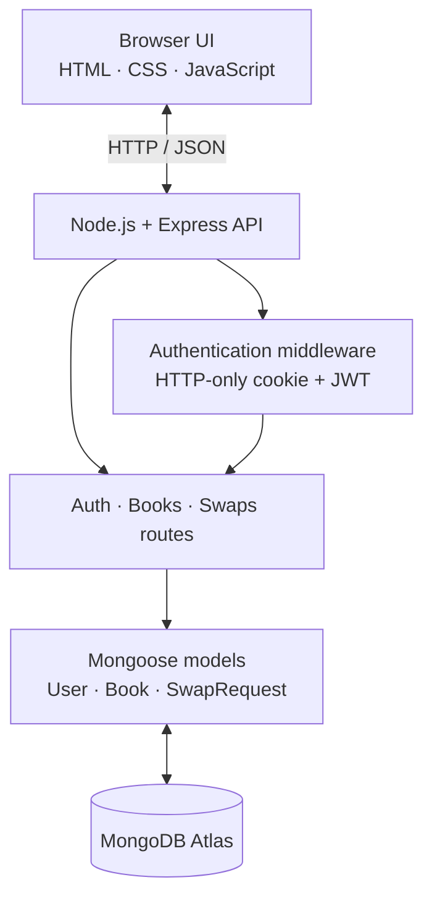

<div align="center">

# BookChain — SwapSafe

### A student-first marketplace for textbook exchange

List textbooks you no longer need, discover books from other students, and request book-for-book swaps.

[**Live Demo**](https://bookchain-swapsafe.onrender.com/) · [**Repository**](https://github.com/Arushi-1011/BookChain-SwapSafe-) · [**Full-Stack Branch**](https://github.com/Arushi-1011/BookChain-SwapSafe-/tree/fullstack-upgrade)


[](https://github.com/Arushi-1011/BookChain-SwapSafe-/actions/workflows/ci.yml?query=branch%3Afullstack-upgrade)

</div>

---

## Live demo

**[Open BookChain — SwapSafe](https://bookchain-swapsafe.onrender.com)**

The app is hosted on Render's free web-service tier and uses MongoDB Atlas. Free services may spin down after inactivity, so the first request after a quiet period can take longer to load.

## Marketplace preview


*Screenshot of the marketplace interface populated with sample listings.*

## What it does

BookChain helps students find and exchange textbooks through a shared marketplace.

- **Discover books:** browse listings and search by title, author, subject, or campus.
- **Filter results:** narrow listings by subject and condition.
- **Manage accounts:** register, sign in and out, and edit profile details.
- **Manage listings:** create, edit, and delete your own eligible book listings.
- **Request a swap:** offer one of your own available books in exchange for another student's listing.
- **Handle requests:** listing owners can accept or decline pending requests; requesters can cancel pending requests; participants can mark accepted swaps complete.
- **Track availability:** accepted swaps reserve both books; completed swaps mark them as swapped.
- **View personal activity:** review incoming, outgoing, and completed swaps and see database-backed marketplace counts.

## Tech stack

| Layer | Technology | Purpose |
|---|---|---|
| Frontend | HTML5, CSS3, vanilla JavaScript | Responsive marketplace interface |
| Backend | Node.js, Express.js | REST API and application logic |
| Database | MongoDB, Mongoose | Persistent users, books, and swap requests |
| Authentication | bcryptjs, JSON Web Tokens | Password hashing and signed sessions in an HTTP-only cookie |
| Security controls | Helmet, express-rate-limit, server-side validation | Security headers, API rate limits, and permission checks |
| Tests | Node.js built-in test runner | Model/schema validation tests |
| Hosting | Render + MongoDB Atlas | Public web app and managed database |

## How it works



The frontend and API are served by the same Express application. Protected routes verify the session cookie and check ownership and allowed status transitions on the server.

## Run locally

### Requirements

- Node.js 22 or newer (the package supports Node.js 20+)
- npm
- A MongoDB database; MongoDB Atlas is one option

### 1. Clone and install

```bash
git clone --branch fullstack-upgrade https://github.com/Arushi-1011/BookChain-SwapSafe-.git
cd BookChain-SwapSafe-
npm ci
```

### 2. Configure environment variables

```bash
cp .env.example .env
```

Edit `.env` with your own development database URI and a unique random secret:

```env
MONGODB_URI=your_development_mongodb_connection_string
JWT_SECRET=replace_with_a_random_secret_of_at_least_32_characters
PORT=3000
NODE_ENV=development
```

Never commit `.env` or expose database credentials/JWT secrets in screenshots, logs, or public issues. Use a separate least-privilege database user and database for production.

### 3. Optional: seed local demo data

```bash
npm run seed
```

This creates a local demo account and sample listings. The script prints the demo credentials in the terminal. If `SEED_DEMO_PASSWORD` is not set, it generates a random local password. The script refuses to run when `NODE_ENV=production`; still, use it only with a development database and never point it at production data.

### 4. Start the app

```bash
npm run dev
```

Open [http://localhost:3000](http://localhost:3000). No separate frontend server is needed.

### 5. Run checks and tests

```bash
npm run check
npm test
```

`npm run check` verifies JavaScript syntax for the server, routes, and browser code. The current automated suite contains seven model/schema validation tests and does not require a live database. These checks are useful, but they are not a substitute for route-level integration tests against a test database.

## API overview

All endpoints return JSON. Protected endpoints require the signed-in user's `bookchain_token` HTTP-only cookie.

### Authentication — `/api/auth`

| Method | Endpoint | Purpose |
|---|---|---|
| `POST` | `/register` | Create an account and start a session |
| `POST` | `/login` | Authenticate and start a session |
| `POST` | `/logout` | Clear the session cookie |
| `GET` | `/me` | Get the current user |
| `PATCH` | `/profile` | Update profile details |
| `GET` | `/profile/stats` | Get listing and swap statistics |

### Books — `/api/books`

| Method | Endpoint | Purpose |
|---|---|---|
| `GET` | `/` | Browse listings; supports `q`, `subject`, and `condition` filters |
| `GET` | `/?mine=true` | View the signed-in user's listings |
| `POST` | `/` | Create a listing |
| `PATCH` | `/:id` | Update an eligible listing you own |
| `DELETE` | `/:id` | Delete an eligible listing you own |

### Swaps — `/api/swaps`

| Method | Endpoint | Purpose |
|---|---|---|
| `GET` | `/` | List incoming, outgoing, or completed requests via the `tab` parameter |
| `GET` | `/summary` | Get request counts for the current user |
| `POST` | `/` | Request a swap using one of your own available books |
| `PATCH` | `/:id/status` | Accept, decline, cancel, or complete a request when permitted |

### Utility endpoints

| Method | Endpoint | Purpose |
|---|---|---|
| `GET` | `/api/health` | Basic API health response |
| `GET` | `/api/stats` | Database-backed marketplace counts |

## Security and engineering notes

- Passwords are stored as bcrypt hashes, not plain text.
- JWTs are stored in an HTTP-only cookie; the cookie is marked `Secure` in production.
- Helmet adds security headers, and rate limiting is applied to API traffic and authentication attempts.
- Server-side validation and ownership checks protect listing changes and swap status updates.
- Environment secrets are configured locally through `.env` and in Render through its environment settings.

## Project scope and next steps

Despite the name, **this version does not implement blockchain or smart contracts**. User accounts, listings, and swap statuses are stored in MongoDB. A verifiable on-chain exchange receipt could be explored as a future extension.

Potential next improvements:

- Add route-level integration tests with a dedicated test database.
- Make swap acceptance and cancellation atomic for concurrent requests.
- Add mutual completion confirmation and notifications.
- Support optional book-cover uploads and in-app messaging.
- Explore verifiable blockchain receipts as a separate optional layer.

## Author

**Arushi Srivastava** · [GitHub profile](https://github.com/Arushi-1011)
