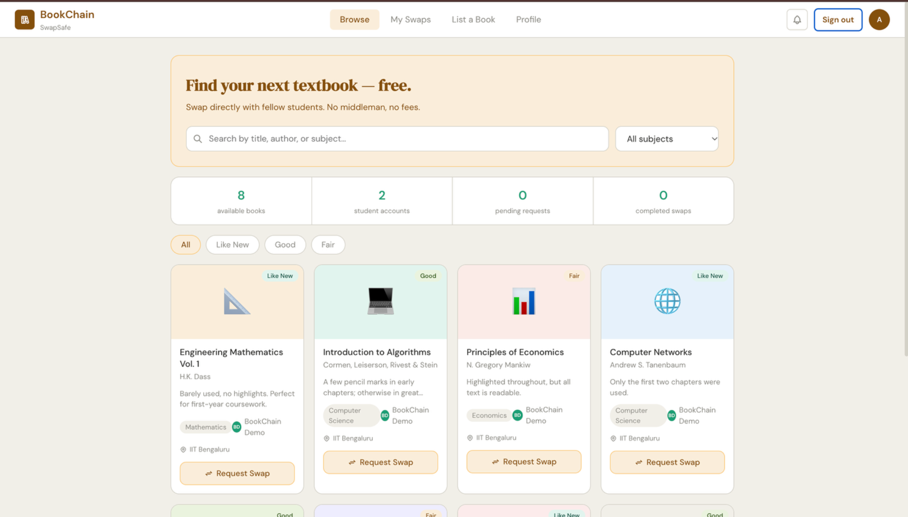
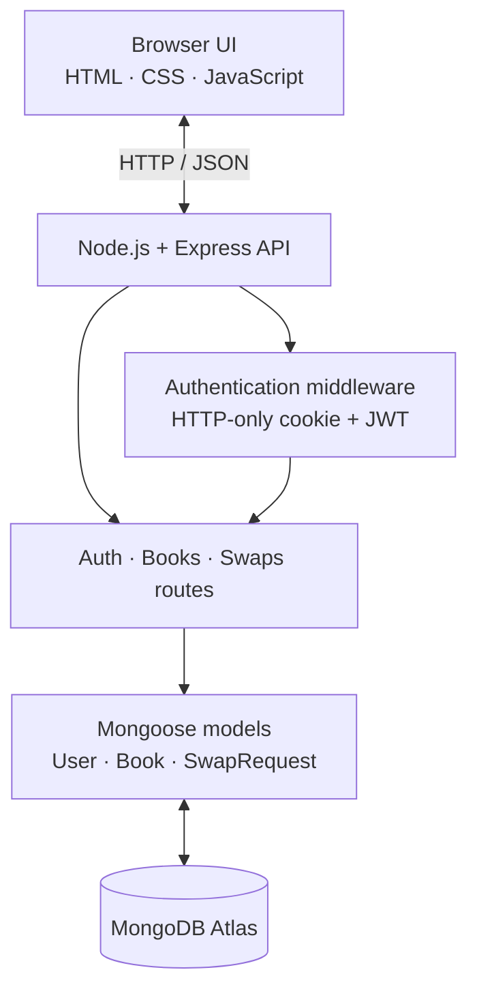

<div align="center">

# BookChain — SwapSafe

### A student-first marketplace for swapping textbooks

Find a book, list one you no longer need, and arrange a book-for-book exchange with another student.

[**Live Demo**](https://bookchain-swapsafe.onrender.com/) · [Repository](https://github.com/Arushi-1011/BookChain-SwapSafe-) · [Full-Stack Branch](https://github.com/Arushi-1011/BookChain-SwapSafe-/tree/fullstack-upgrade)


</div>

---

## Overview

**BookChain — SwapSafe** is a full-stack web application designed to help students discover, list, and exchange textbooks. The application started as a vanilla HTML/CSS/JavaScript prototype and now uses an Express REST API and MongoDB for persistent data.

The core exchange flow is implemented: a signed-in student can offer one of their available books for another student's listing; the owner can accept or decline; and participants can track the request through its status changes.

> **Project scope:** Despite the name, this version does not currently use a blockchain or smart contracts. Book listings, accounts, and swap states are stored in MongoDB. A verifiable on-chain exchange record is a possible future extension, not a current feature.

## Live demo

**[Open BookChain — SwapSafe](https://bookchain-swapsafe.onrender.com)**

The live app is hosted on Render's free web-service tier. Free services may spin down when idle, so the first page load after a quiet period can take longer than usual.

### Marketplace preview



*Marketplace UI populated with sample book listings for demonstration.*

## Features

- **Discover books:** browse available listings and search by title, author, subject, or campus.
- **Filter listings:** narrow results by subject and book condition.
- **Account management:** register, sign in/out, and update student profile details.
- **Book listing management:** create, edit, and delete your own available listings.
- **Book-for-book swaps:** submit a request by offering one of your available books.
- **Request lifecycle:** listing owners can accept or decline pending requests; requesters can cancel pending requests; participants can mark an accepted exchange complete.
- **Availability management:** accepted exchanges reserve the two books; completed exchanges mark them as swapped.
- **Personal dashboard:** review incoming, outgoing, and completed swap requests, plus listing and swap statistics.
- **Database-backed metrics:** marketplace statistics are calculated from MongoDB rather than hard-coded counters.
- **Responsive interface:** custom HTML, CSS, and vanilla JavaScript; no frontend framework required.

## Tech stack

| Layer | Technology | Purpose |
|---|---|---|
| Frontend | HTML5, CSS3, vanilla JavaScript | Marketplace interface and browser interactions |
| Backend | Node.js, Express.js | Same-origin REST API and application logic |
| Database | MongoDB, Mongoose | Persistent users, book listings, and swap requests |
| Authentication | bcryptjs, JSON Web Tokens | Password hashing and signed sessions in an HTTP-only cookie |
| Security | Helmet, express-rate-limit, server-side validation | Security headers, request limits, and input/permission checks |
| Tests | Node.js built-in test runner | Model/schema validation tests |
| Deployment | Render + MongoDB Atlas | Hosted application and managed database |

## Architecture



The frontend and API are served from the same Express application. Protected endpoints read the `bookchain_token` HTTP-only cookie, verify the session, and enforce ownership and state-transition rules on the server.

## Run locally

### Prerequisites

- Node.js 20 or newer
- npm
- A MongoDB database (MongoDB Atlas is the easiest option)

### 1. Clone the repository

```bash
git clone --branch fullstack-upgrade https://github.com/Arushi-1011/BookChain-SwapSafe-.git
cd BookChain-SwapSafe-
```

### 2. Install dependencies

```bash
npm ci
```

### 3. Configure environment variables

Create a local `.env` file from the example:

```bash
cp .env.example .env
```

Set the values in `.env`:

```env
MONGODB_URI=your_mongodb_connection_string
JWT_SECRET=replace_with_a_random_secret_of_at_least_32_characters
PORT=3000
NODE_ENV=development
```

- `MONGODB_URI`: connection string for your own development database.
- `JWT_SECRET`: unique, random secret of at least 32 characters.
- `PORT`: optional local port; defaults to `3000`.
- `NODE_ENV`: use `development` locally and `production` when deployed behind HTTPS.

Never commit `.env`, send database credentials in screenshots, or expose your JWT secret. The repository's `.gitignore` excludes `.env`.

### 4. Seed optional sample data

```bash
npm run seed
```

The seed script creates a local demo user and adds eight sample listings if that demo user has no books yet. It prints the demo credentials in the terminal. This is **development-only**: use your own `SEED_DEMO_PASSWORD` if needed, and **never run `npm run seed` against the production database**.

### 5. Start the application

```bash
npm run dev
```

Open [http://localhost:3000](http://localhost:3000). The Express server serves both the frontend and API, so a separate frontend server is not required.

### 6. Run checks and tests

```bash
npm run check
npm test
```

- `npm run check` runs Node.js syntax checks on the server, route files, and browser JavaScript.
- `npm test` runs model validation tests using Node's built-in test runner. These tests do not require a live database; they are not a substitute for route-level integration tests.

## REST API overview

All endpoints return JSON. Protected routes require the signed-in user's `bookchain_token` cookie.

### Authentication — `/api/auth`

| Method | Endpoint | Description |
|---|---|---|
| `POST` | `/register` | Create account and start a session |
| `POST` | `/login` | Authenticate and start a session |
| `POST` | `/logout` | Clear the session cookie |
| `GET` | `/me` | Get the current user |
| `PATCH` | `/profile` | Update profile details |
| `GET` | `/profile/stats` | Get current user's listing/swap statistics |

### Books — `/api/books`

| Method | Endpoint | Description |
|---|---|---|
| `GET` | `/` | Browse available books; supports `q`, `subject`, and `condition` filters |
| `GET` | `/?mine=true` | View the current user's own listings (authentication required) |
| `POST` | `/` | Create a listing |
| `PATCH` | `/:id` | Update an owned, available listing |
| `DELETE` | `/:id` | Delete an eligible owned listing |

### Swaps — `/api/swaps`

| Method | Endpoint | Description |
|---|---|---|
| `GET` | `/` | List requests; supports `tab=incoming`, `tab=outgoing`, or `tab=completed` |
| `GET` | `/summary` | Counts for the current user's request tabs |
| `POST` | `/` | Request a swap by offering one of the current user's books |
| `PATCH` | `/:id/status` | Accept, decline, cancel, or complete a request subject to permissions and current status |

### Utilities

| Method | Endpoint | Description |
|---|---|---|
| `GET` | `/api/health` | API health response |
| `GET` | `/api/stats` | Database-backed marketplace counts |

## Data models

- **User:** name, unique email, password hash, course/year/campus profile fields, and timestamps.
- **Book:** title, author, subject, condition, ISBN, notes, campus, owner, availability state, and timestamps.
- **SwapRequest:** requested book, offered book, requester, owner, status, message, and response/completion timestamps.

## Security and engineering decisions

- Passwords are hashed with bcrypt; plain-text passwords are not stored in the User model.
- JWT sessions are held in an HTTP-only, `SameSite=Lax` cookie; the cookie is marked `Secure` in production.
- Helmet adds security headers, and rate limiting is applied to API traffic and authentication attempts.
- Input validation runs server-side; listing updates/deletions and swap status changes check permissions on the server.
- Swap requests validate book ownership, availability, and eligible state transitions.
- Environment-specific configuration is supplied through `.env` locally and service environment variables in production.

## Deployment notes

The live demo is deployed on Render and uses MongoDB Atlas.

For a new deployment, configure these environment variables in the host dashboard:

- `MONGODB_URI` — a production database connection string and least-privilege database user.
- `JWT_SECRET` — a unique random secret; do not reuse your local value.
- `NODE_ENV=production`.

Use the platform-provided `PORT`. Configure Atlas Network Access to allow the hosting service's required outbound IP ranges. Never deploy using the local demo account or run the seed script against production data.

## Roadmap

- Add route-level integration tests using a dedicated test database.
- Make swap acceptance and cancellation atomic for concurrency edge cases.
- Add mutual completion confirmation for exchanges.
- Add optional book-cover uploads, in-app messaging, and notifications.
- Explore verifiable blockchain receipts for completed swaps as a separate, optional layer.

## Author

**Arushi Srivastava** · [GitHub profile](https://github.com/Arushi-1011)
